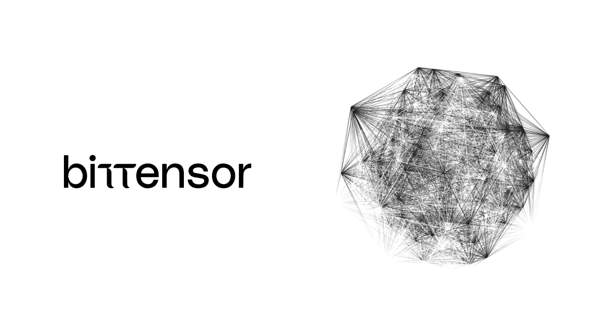

# srdev23

**Bittensor & Web3 Engineer**

AI agents · Subnet infrastructure · Full-stack products

[Projects](#selected-work) · [Subnet work](#subnet-work) · [Telegram](https://t.me/srdev23)

I build tools that make decentralized systems easier to operate—from subnet analytics and registration automation to agent evaluation and web applications. My current work centers on **Bittensor**, alongside a background in **Solana and EVM development**.

  

## Selected work

### Bittensor Subnet Monitor

A full-stack dashboard for emissions, registration costs, miner performance, historical trends, and watchlists. Shared caching, persistent API budgets, and resumable collection keep data requests efficient.

### [Bittensor Registration Bot](https://github.com/srdev23/bt-regbot)

Telegram registration workflows with persistent orders, isolated wallet sessions, and shared RPC polling. Registrations run when costs meet a configured threshold.

### ORO Tops

An operator dashboard for SN15 agents and hotkeys: race participation, field-relative scores, rankings, registration status, and submission cooldowns.

## Subnet work

###  ORO · SN15

Developing and evaluating commerce agents for **ORO Bench**, alongside the monitoring tools I use to compare runs and track participation. My focus is on local evaluation, understanding scoring behavior, and improving the agent iteration workflow.

[Official site](https://oroagents.com/) · [Miner documentation](https://oroagents.com/docs/miners/overview)

###  SOMA · SN114

Developing **context-compression miners** and evaluation tooling for AI agents. I experiment with compression thresholds, token-cost simulation, and fidelity checks, with attention to cache stability and preserving tool-call structure.

[Official site](https://thesoma.ai/) · [Subnet repository](https://github.com/DendriteHQ/SOMA)

## Technical focus

| Area | Tools & experience |
| :--- | :--- |
| **AI & subnets** | Python, Bittensor SDK, ORO SDK, agent evaluation, context compression |
| **Backend & data** | FastAPI, asyncio, Node.js, PostgreSQL, Redis, SQLite |
| **Web applications** | TypeScript, React, Next.js, wallet integrations |
| **Blockchain** | Solana, Ethereum / EVM, Rust, Solidity |
| **Operations** | Docker, Linux, API integration, caching, monitoring |

## Web3 background

My earlier work includes cross-chain integrations for **[HeroSwap](https://heroswap.com/)** and Solana NFT marketplace development, covering smart-contract integration, wallet flows, auctions, and notifications.

---

Open to collaboration on **Bittensor tooling, agent evaluation, and Web3 infrastructure**. [Get in touch on Telegram →](https://t.me/srdev23)
