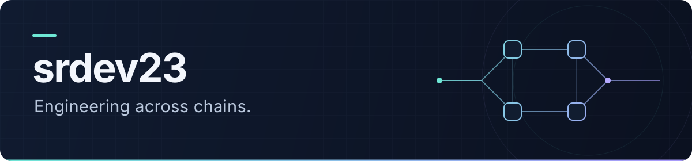
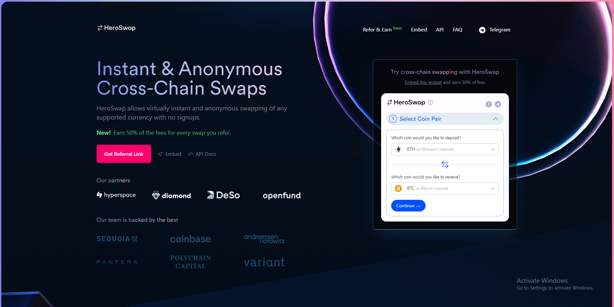
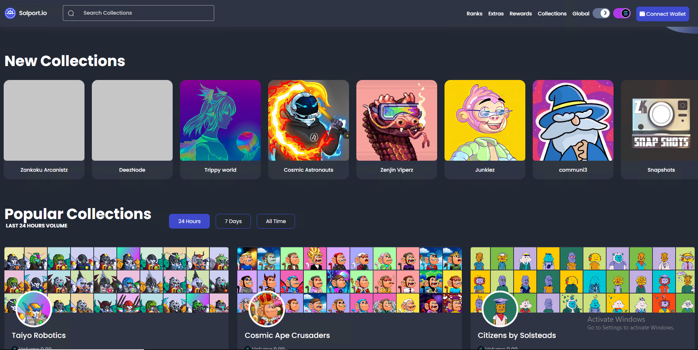

  

<h1 align="center">Blockchain &amp; Web3 Engineer</h1>

  <strong>Solana · Ethereum / EVM · Full-stack development</strong> 
  From on-chain programs to the products people use.

  <a href="#selected-work">Selected work</a> &nbsp;·&nbsp;
  <a href="#technical-focus">Technical focus</a> &nbsp;·&nbsp;
  <a href="https://t.me/srdev23">Get in touch ↗</a>

---

I build blockchain products across **Solana and EVM**, connecting smart contracts and on-chain programs with backend services and user interfaces. My experience spans cross-chain exchanges, NFT marketplaces, wallet integrations, and the infrastructure behind them.

I care about clear architecture, reliable transaction flows, and interfaces that make complex on-chain interactions easier to use.

## Selected work

### HeroSwap

**Cross-chain exchange · Integrations & product architecture**

A swap product that connects users and applications across blockchain ecosystems.

**My contributions:** Core integrations, on-chain and off-chain architecture, and user flows for fast, reliable swaps.

[Explore HeroSwap ↗](https://heroswap.com/)

  
View project screenshot

   
  
  
Screenshot preserved from my original portfolio.

### Solport

**Solana NFT marketplace · Trading flows & collection tooling**

A marketplace for discovering and trading Solana NFT collections.

**My contributions:** Listing and auction flows, rarity features, and Discord/Telegram notification integrations for collectors and creators.

  
View project screenshot

   
  
  
Screenshot preserved from my original portfolio.

## Technical focus

| Area | Tools & experience |
| :--- | :--- |
| **On-chain** | Solana, Ethereum / EVM, Rust, Solidity, smart contract architecture |
| **Backend** | TypeScript, Node.js, PostgreSQL, Redis, APIs, queues |
| **Frontend** | React, Next.js, Tailwind CSS, Phantom & MetaMask integrations |
| **Automation** | Python, LLM-powered tooling, on-chain workflows |

## Let's build

Open to collaboration on **DeFi, cross-chain products, NFT platforms, and full-stack Web3 applications**.

[Start a conversation on Telegram ↗](https://t.me/srdev23)
